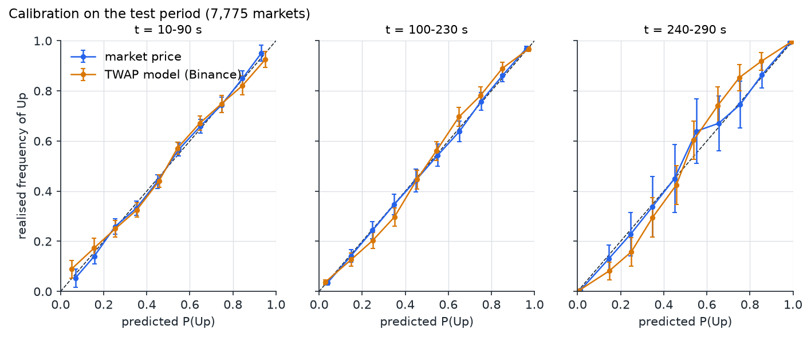
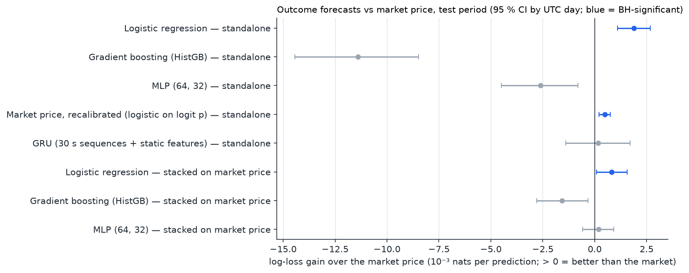
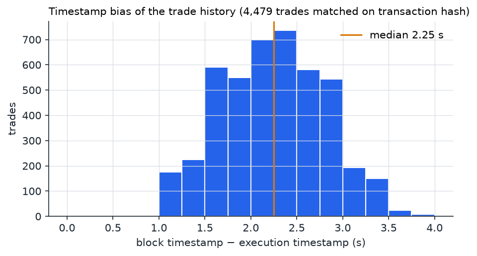
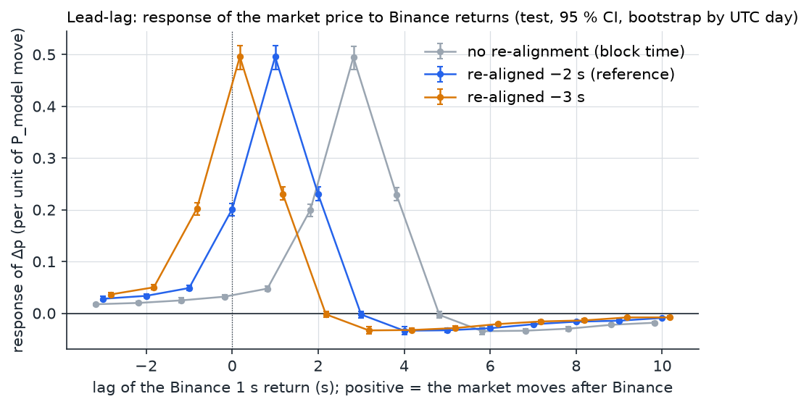
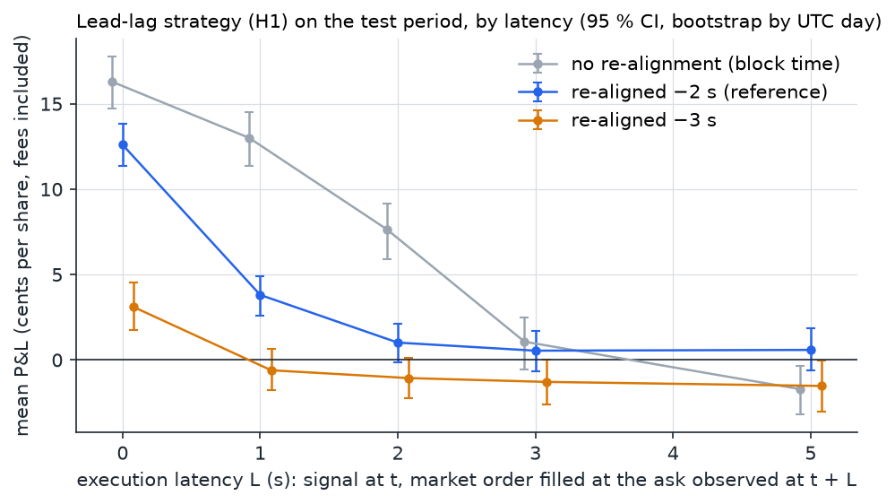

# Study on Prediction Markets: price formation in BTC 5-min markets

## 1. Question and summary

**Question.** Does the price of 5-minute "Bitcoin Up or Down" Prediction Market contracts absorb public information (the
Binance price, its own path) fast and accurately enough to leave no edge to a trader who takes liquidity (taker)?

**Answer, on 7,775 held-out markets (27 test days).** The market price is well calibrated and absorbs a Binance move
within about 1 s. None of the 10 taker or limit-order strategies in the tested families shows a positive P&L that
survives Benjamini–Hochberg correction, at 2 s execution latency for the tests specified before the test evaluation.
Confidence intervals come from a bootstrap that resamples UTC days. Signals beyond the price exist but are small: the
best ML gain is 0.0019 nats (best of 8 models), 0.5 % of the market's log-loss. A 2.25 s timestamp bias in the trade
history creates a fake +7.6 c/share lead-lag edge if it is not corrected.

## 2. Data

| | |
|---|---|
| Venue | Prediction Market "Bitcoin Up or Down – 5 min": one binary market per 5-minute window. Up pays 1 $ if the 60-second TWAP of Chainlink BTC/USD at the end of the window ≥ the TWAP at its start |
| Period | Markets starting 2026-08-17 00:00 → 2026-10-17 23:50 UTC (62 days) |
| Markets | **17,559** analysed (out of 17,856 five-minute windows in the period) |
| Trades | **28,594,392** taker trades on these markets (26,956,412 inside the 5-minute windows), 435.7 M USDC notional |
| Reference price | Binance BTCUSDT aggregated trades: 58,105,834 trades, resampled to 1-second bars |
| Per-second panel | 5,267,700 market-second rows (17,559 × 300) + 5,358,300 Binance 1-second rows = **10.6 M rows** |

**Sources.** Market metadata and outcomes come from the venue's public market API. Trades come from its public
trade-history API (taker side, one row per match), checked against on-chain `OrderFilled` events on Polygon: 9,018 out
of 9,018 trades match on 4 markets. Binance data comes from `data.binance.vision`. Details are in
[docs/data_notes.md](docs/data_notes.md).

**Filters** (in [analysis/data.py](analysis/data.py)):

| Step | Markets |
|---|---|
| Five-minute windows from 2026-08-17 to 2026-10-17 | 17,856 |
| Listed by the market API | 17,855 |
| Resolved, with an outcome | 17,855 |
| At least one trade inside [0, 300 s) (drops the 2026-09-19 venue outage, among others) | 17,560 |
| Binance available from start − 1,800 s to start + 300 s | **17,559** |

The study starts on 2026-08-17 because the resolution rule changed in early August. Until ~2026-08-10 the markets
resolved on the Chainlink *spot* price; since then they resolve on the 60-second TWAP. The fair-value model only applies
to the TWAP period.

**Raw data are not in the repository** (several GB). `bash reproduce.sh --download` rebuilds them from the public APIs.
`data_sample/` holds the only data that cannot be downloaded again: the 4,479 (execution time, block time) pairs of the
timestamp measurement (section 5). They contain no hashes and no wallets.

## 3. Method

- **Train/test split by date.** Exploration on markets before **2026-09-21** (9,784 markets) and test from 2026-09-21
  (7,775 markets). Every free parameter is chosen on the exploration period only:
  - the fair-value model (k, τ);
  - each strategy's threshold, which must give at least 200 trades on train;
  - ML hyperparameters, early stopping and stacking weights (on the last 5 days of train).
- **Use of the test set.** The test set was used to detect two data artefacts (stale ask, timestamp bias). After
  these corrections, each configuration was evaluated once on the test period.
- **Statistical unit and dependence.** Each strategy takes at most one position per market. The 288 markets of a day
  share one volatility regime, and some features use the previous window, so markets are not independent. Confidence
  intervals and p-values therefore come from a **block bootstrap that resamples UTC days** (27 test days;
  [analysis/blockboot.py](analysis/blockboot.py)). It is used for every P&L, for the regressions (H1 lead-lag,
  H2-info, A9) and for the ML log-loss gains, and the verdicts rely on it. A bootstrap that resamples markets is kept
  as a secondary column, and a bootstrap by UTC hour is a sensitivity analysis (full table:
  [results/hypotheses.md](results/hypotheses.md)). Draws: 2,000 for the P&L and log-loss means, 500 for the H1
  regression and the H2 logit, 300 for the A9 logit. P&L p-values are one-sided (H0: mean P&L ≤ 0).
- **Multiple testing.** Benjamini–Hochberg at q = 0.05, applied **within each family**:
  - **P**, the protocol specified before the test evaluation: H1, H2, H2-info, H3, H4;
  - **A**, price-path strategies: A1, A2, A4–A7;
  - **I**, information beyond the price: A9–A11;
  - the 8 ML models.
  A3 is not in any family: its market cluster uses the whole price path, so it is reported as an ex-post diagnostic.
  No hypothesis is called positive or significant unless it is significant after this correction (day bootstrap).
- **Real costs.** The taker fee is 0.07 · p · (1 − p) per share, verified on-chain (1.75 c at 50 c, 0.33 c at 95 c).
- **Execution.** The decision uses only what is known at the end of second t. A market order is filled at the ask
  observed at t + L:
  - L = 2 s for H1–H4, plus a sensitivity analysis over L ∈ {0, 1, 2, 3, 5};
  - L = 1 s for the A-family, which favours the strategy.
  There is no historical order book, so the ask is the last taker buy of the last 3 s, floored by the mirror book
  (ask_up ≥ 1 − last buy of Down). The position is held to resolution unless the strategy defines an exit.
- **Fair-value model (H2).** P(Up | Binance) = Φ(ln(E[A1 | S_t] / A0) / sd), with:
  - A0 and A1 the Binance 60 s TWAPs at the start and end of the window;
  - sd² = (kσ)² V(t) + τ², where V(t) is the exact variance of the remaining part of a Brownian average and σ is a
    causal 30-minute realised volatility.
  Fitted on train: k = 1.15, τ = 4·10⁻⁵. The model reproduces the outcome at t = 299 s in 98.0 % of test markets.

## 4. Results

### 4.1 Hypotheses (test period)

All P&L figures are per share (1 share pays 1 $ if it wins), fees included. The 95 % CI and p adj. come from the
bootstrap by UTC day; p adj. is the Benjamini–Hochberg-adjusted p-value within the family. The last two columns repeat
the CI and p adj. with the bootstrap by market. Full table with raw p-values and the bootstrap by UTC hour:
[results/hypotheses.md](results/hypotheses.md).

| ID | Hypothesis | Execution | Estimate | 95 % CI (day) | n | p adj. (day) | Verdict | 95 % CI (market) | p adj. (market) |
|---|---|---|---|---|---|---|---|---|---|
| **P** | *protocol specified before the test evaluation* | | | | | | | | |
| H1 | Lead-lag: buy when Binance moves ≥ 4 σ in 3 s while the market price has not moved | taker, 2 s | +1.0 c | [−0.1, +2.1] | 2,570 | 0.086 | Not significant after BH | [−0.1, +2.2] | 0.111 |
| H2 | TWAP fair value: buy the side priced below the Binance model (θ = 5 c) | taker, 2 s | −2.7 c | [−3.9, −1.6] | 6,821 | 1.000 | Rejected: negative P&L | [−3.8, −1.7] | 1.000 |
| H2-info | Model − market predicts the outcome: logit coefficient c | – | c = 0.124 | [0.031, 0.215] | 69,975 obs. | 0.020 | Information detected; the strategy built on it (H2) loses | [0.055, 0.195] | 0.010 |
| H3 | Fade price jumps that Binance does not justify (jump ≥ 8 c in 5 s) | taker, 2 s | −2.2 c | [−3.3, −1.2] | 6,974 | 1.000 | Rejected: negative P&L | [−3.3, −1.1] | 1.000 |
| H4 | Late favourites: buy the favourite at t = 260 s if its ask ∈ [0.80, 0.98] | taker, 2 s | −0.4 c | [−1.6, +0.7] | 1,313 | 1.000 | Rejected: negative P&L | [−1.9, +0.9] | 1.000 |
| **A** | *price-path strategies* | | | | | | | | |
| A1 | Dip-buy: buy a side ≤ 30 c, sell at ≥ 33 c | taker, 1 s | −6.0 c | [−6.6, −5.4] | 4,614 | 1.000 | Rejected: negative P&L | [−6.5, −5.4] | 1.000 |
| A2 | Dip-buy grid (216 cells: level × target × window), best train cell | limit order | −1.0 c | [−1.1, −0.8] | 870 | 1.000 | Rejected: negative P&L | [−1.1, −0.8] | 1.000 |
| A4 | Gradient-boosting classifier picks the dips that rebound (AUC 0.59) | limit order | −1.4 c | [−2.5, −0.4] | 466 | 1.000 | Rejected: negative P&L | [−2.5, −0.4] | 1.000 |
| A5 | Pre-open momentum: buy the side of the last 1-min Binance trend | taker, 1 s | −3.6 c | [−4.7, −2.5] | 5,393 | 1.000 | Rejected: negative P&L | [−5.0, −2.3] | 1.000 |
| A6 | TWAP anchor at the open: buy model − opening price | taker, 1 s | −3.0 c | [−5.8, −0.3] | 1,541 | 1.000 | Rejected: negative P&L | [−5.2, −0.3] | 1.000 |
| A7 | End-of-window sniping: buy at ≤ 99 c a side the model gives > 99.5 % | taker, 1 s | −0.8 c | [−13.1, +5.7] | 23 | 1.000 | Rejected: negative P&L, and almost no opportunity | [−10.7, +5.8] | 1.000 |
| A8 | Pair arbitrage: Up + Down asks < 1 $ | – | 52 % of seconds | – | 919,083 s | – | Artefact: the two prices come from different instants of the same second; not tested | – | – |
| **I** | *information beyond the price* | | | | | | | | |
| A9 | Under-reaction at the open (10–40 s): slope of the outcome on logit(price), H0: slope = 1 | – | 1.223 | [1.158, 1.290] | 7,766 | < 0.001 | Information detected (statistical test, not a P&L test) | [1.150, 1.304] | < 0.001 |
| A10 | ML outcome forecast stacked on the market price: log-loss gain | – | +0.0008 nats | [+0.0001, +0.0016] | 69,894 obs. | 0.014 | Information detected (statistical test, not a P&L test) | [+0.0001, +0.0016] | 0.018 |
| A11 | The price residual not explained by Binance leads the next 10 s Binance move: correlation | – | 0.082 | [0.076, 0.088] | 7,766 | < 0.001 | Information detected (statistical test, not a P&L test); see the robustness checks in section 5 | [0.079, 0.086] | < 0.001 |

**Ex-post diagnostic (not in any BH family).**

| ID | Diagnostic | Execution | Estimate | 95 % CI (day) | n | 95 % CI (market) | Status |
|---|---|---|---|---|---|---|---|
| A3 | Dip-buy 30 → 33 c inside the "hesitant" market cluster | limit order | +1.9 c | [+1.7, +2.2] | 2,236 | [+1.7, +2.2] | The cluster is defined from the whole price path (look-ahead): not a tradable strategy, so it is not tested |

**Reading.** No strategy in the tested families has a positive P&L that survives the multiple-testing correction. A3
is positive, but its cluster uses the whole price path, so it is not tradable in real time and is reported apart. The
four information tests (H2-info, A9–A11) find statistically detectable effects of a few probability points. The
hypotheses were not built to turn these effects into a P&L, and none of the tested strategies pays the spread and fees
with them. With the bootstrap by day, the smallest edge detectable with 80 % power is 1.3 to 1.5 c/share for H1–H4
(1.4 to 1.7 c/share with the bootstrap by market).



*Figure 1. Calibration on the test period, pooled over snapshots every 10 s. x: mean predicted P(Up) in each decile;
y: realised frequency of Up. Error bars: 95 % binomial intervals with n divided by the number of snapshots per market
(conservative for within-market correlation). The market price (blue) is on the diagonal. The Binance TWAP model
(orange) is over-confident late in the window. Test log-loss of the market vs the model: 0.592 vs 0.603 (10–90 s),
0.382 vs 0.403 (100–230 s), 0.077 vs 0.101 (240–290 s).*

### 4.2 Machine learning and deep learning

The task is to forecast the outcome at t = 30, 60, …, 270 s. There are 28 features known at t: market price and its
changes, Binance returns and volatility, model fair value, order flow, volume, spread, hour and previous window. The
score is the log-loss gain over the market price on the test period (69,894 market × snapshot predictions), with a
95 % CI from the bootstrap by UTC day (the bootstrap by market is in [results/ml.md](results/ml.md)). Models:

- logistic regression (standardised, C = 1);
- gradient boosting (scikit-learn HistGradientBoosting, early stopping);
- MLP (64, 32);
- GRU (PyTorch, hidden size 32) on the last 30 s of 6 channels, plus the static features;
- "stacked" variants: a logistic regression on [logit p_market, logit p_model], fitted on the last 5 training days.

| Model | Setting | Log-loss (model) | Log-loss (market) | Gain (nats) | 95 % CI (day) | p adj. (day) |
|---|---|---|---|---|---|---|
| Logistic regression | standalone | 0.3864 | 0.3883 | **+0.0019** | [+0.0011, +0.0027] | < 0.001 |
| Gradient boosting (HistGB) | standalone | 0.3997 | 0.3883 | −0.0114 | [−0.0144, −0.0085] | 1.000 |
| MLP (64, 32) | standalone | 0.3909 | 0.3883 | −0.0026 | [−0.0045, −0.0008] | 1.000 |
| Market price, recalibrated (logistic on logit p) | standalone | 0.3878 | 0.3883 | +0.0005 | [+0.0002, +0.0008] | 0.001 |
| GRU (30 s sequences + static features) | standalone | 0.3883 | 0.3885 | +0.0002 | [−0.0014, +0.0017] | 0.670 |
| Logistic regression | stacked on market price | 0.3874 | 0.3883 | +0.0008 | [+0.0001, +0.0016] | 0.039 |
| Gradient boosting (HistGB) | stacked on market price | 0.3898 | 0.3883 | −0.0016 | [−0.0028, −0.0003] | 1.000 |
| MLP (64, 32) | stacked on market price | 0.3881 | 0.3883 | +0.0002 | [−0.0006, +0.0009] | 0.616 |

**Reading.** The flexible models (boosting, MLP) do worse than the market price out of sample, and the GRU does not beat
it. The best gain is +0.0019 nats (logistic regression, best of 8 models), 0.5 % of the market's log-loss. It is the
maximum over 8 models evaluated on the test period, so it is an optimistic figure. A quarter of that gain
(+0.0005) comes from simply recalibrating the market price. The market price is a near-sufficient statistic for the
public information used here.



*Figure 4. Log-loss gain over the market price on the test period, in 10⁻³ nats per prediction; > 0 means better than
the market. Bars: 95 % CI, bootstrap by UTC day. Blue: significant after BH across the 8 models.*

## 5. Measurement: the 2.25 s timestamp bias

The trade-history API timestamps each trade with its **Polygon block**, not with its execution. Over one day, a live
capture of the venue's WebSocket gave the execution time (ms) of trades. These were matched on transaction hash with
the trade history. **4,479 trades** matched: block − execution has a median of **2.25 s** (p1 1.09 s, p99 3.47 s,
mean 2.24 s).



*Figure 5. Distribution of block timestamp − execution timestamp, in seconds (4,479 trades; bins of 0.25 s).*

**Consequence.** Read at block time, the market seems to react to Binance ~3 s late. The lead-lag strategy then looks
like a strong edge: +7.6 c/share at L = 2 s, BH-adjusted p = 0.002 (bootstrap by day or by market). Every series built from trades is therefore
re-aligned by −2 s (the median, rounded to the 1-second grid). After re-alignment, the response peaks at a lag of 1 s.
Given the true 2.25 s offset, the actual peak is closer to 0.75 s, and only 9 % of the response arrives after 2 s.



*Figure 2. Response of the market price change Δp_t to the change of the Binance fair value ΔP_{t−lag}. These are the
coefficients of a single distributed-lag regression, test period, with 95 % CI from a bootstrap by UTC day (500 draws).
Grey: block time. Blue: −2 s (reference). Orange: −3 s.*

**Full sensitivity of the lead-lag strategy (H1)** to the re-alignment and to the execution latency L. Test period;
mean P&L in c/share with 95 % CI from the bootstrap by UTC day (the bootstrap by market is in
[results/latency.md](results/latency.md)).

| Re-alignment | L = 0 s | L = 1 s | L = 2 s | L = 3 s | L = 5 s |
|---|---|---|---|---|---|
| none (block time) | +16.3 [+14.7, +17.8] | +13.0 [+11.4, +14.5] | +7.6 [+5.9, +9.1] | +1.1 [−0.5, +2.5] | −1.7 [−3.2, −0.3] |
| **−2 s (reference)** | +12.6 [+11.4, +13.8] | **+3.8 [+2.6, +4.9]** | +1.0 [−0.1, +2.1] | +0.5 [−0.6, +1.7] | +0.6 [−0.6, +1.8] |
| −3 s | +3.1 [+1.8, +4.5] | **−0.6 [−1.8, +0.7]** | −1.1 [−2.2, +0.1] | −1.3 [−2.6, +0.0] | −1.5 [−3.0, −0.0] |

*The latency grid is a robustness check: it is not part of the BH family.*



*Figure 3. Mean P&L of the lead-lag strategy (c/share, fees included) by execution latency, for three re-alignments;
95 % CI, bootstrap by UTC day.*

**Reading.** At 1 s latency, the result depends entirely on the re-alignment: +3.8 c with −2 s, −0.6 c with −3 s. The
true offset (2.25 s) lies between the two, so this study cannot tell whether a 1-second taker earns anything. From 2 s
of latency, neither the −2 s nor the −3 s re-alignment gives a CI above zero. **Conclusion: no taker edge from 2 s of latency; whether an
edge exists below that depends on a sub-second clock that the trade history does not provide.**

### A11 and the timestamp shift

After the −2 s shift, the block − execution gap (p1 1.09 s) places some trades up to 0.91 s before their real
execution. Their price can then appear to anticipate a Binance move that had already happened, which would create a
mechanical lead in A11. Three checks, on the same 7,766 test markets (mean per-market correlation, 95 % CI by UTC day;
[results/a11_robustness.json](results/a11_robustness.json)):

| Re-alignment of the market series | Binance from t to t + 10 s | Binance from t + 2 to t + 12 s |
|---|---|---|
| none (block time: no trade placed before its execution) | 0.024 [0.015, 0.035] | 0.027 [0.018, 0.036] |
| −2 s (reference) | 0.082 [0.076, 0.088] | 0.067 [0.060, 0.073] |
| −3 s (trades up to 1.91 s early) | 0.137 [0.131, 0.143] | 0.092 [0.086, 0.097] |

The correlation stays positive in every cell, including the two settings that rule out the mechanism: block time, where
no trade is placed before its execution, and a Binance horizon that starts at t + 2 s, later than any early placement
under −2 s or −3 s. A11 is therefore the most robust signal of the study: the price residual carries information about
Binance moves at least 2 s ahead. Its size is not identified. It grows as trades are placed earlier (0.024, 0.082,
0.137 from block time to −3 s), so part of the reference value is mechanical, and the lower bound is a correlation of
0.024 to 0.027. It is a statistical test on the price, not a P&L test.

## 6. Limitations

- **Short period.** 2 months (62 days), with 27 days of test, all in the TWAP-resolution period. Edges below ~1.5
  c/share are not detectable with this sample (80 % power).
- **One asset.** Only BTC 5-minute markets. Other assets, horizons (15 min, 1 h) and venues are untested.
- **Dependence on the re-alignment.** Every Prediction Market–Binance comparison depends on the −2 s shift, estimated
  from a single day of live capture (4,479 trades). The result at L ≤ 1 s changes sign between −2 s and −3 s
  (section 5).
- **No robustness test across market regimes.** There is no split by volatility regime or trend, and no test on another
  period such as the spot-resolution era before August 2026.
- **Execution without an order book.** The ask is approximated by the last taker buy (≤ 3 s, mirror-book floor). This is
  valid for a small size only. When no taker buy occurred in the last 3 s, the ask is missing and the signal is skipped. Queue position for limit
  orders (A2–A4) is not modelled: a limit order counts as filled only when a trade goes *through* its price.
- **Chainlink vs Binance.** Resolution uses Chainlink and the model uses Binance. The level gap is neutralised by working
  in returns, but differences in dynamics are not modelled.

## 7. Reproduce

**Environment.** Python 3.13, CPU only; the published run used an Intel Core i5-14600KF with 32 GB of RAM.

```bash
python -m venv .venv
.venv/Scripts/python -m pip install -r requirements.txt --extra-index-url https://download.pytorch.org/whl/cpu   # Linux/macOS: .venv/bin/python
.venv/Scripts/python -m pip install -e . --no-deps
.venv/Scripts/python -m pytest -q
```

**Commands.**

```bash
bash reproduce.sh --download   # download (~30-60 min, a few GB in data/), then all analyses, tables and figures
bash reproduce.sh              # analyses, tables and figures only, from data/ already built
```

Outputs:

- `results/*.json`: raw outputs of each analysis.
- `results/hypotheses.md`, `results/ml.md`, `results/latency.md`: the tables of this README.
- `results/key_figures.md`: every headline number with its source file.
- `figures/*.png`: the figures.

Each step's wall time is written to `results/runtime.log`.

**Random seeds.** NumPy generators are seeded: `20261018` in `analysis/run.py` and `7` in `analysis/deep.py`, which
`edges*` reuse. scikit-learn models use `random_state=0`, and PyTorch uses `torch.manual_seed(0)`. `reproduce.sh` also
sets `PYTHONHASHSEED=0`. Two consecutive runs gave identical tables and figures; the JSON outputs differ only in their timing fields (and by < 10⁻¹² from summation order).

**Run time** (analyses only, on the machine above):

| Step | Time |
|---|---|
| H1–H4, three re-alignments (`analysis.run 0/2/3`) | 2 min 25 s |
| Per-second panel cache (`analysis.deep_data`) | 54 s |
| A9–A11 (`analysis.deep AB`, `analysis.deep_extra`) | 31 s |
| ML / DL incl. GRU (`analysis.deep D`, `analysis.deep_stack`) | 1 min 01 s |
| A1–A8 (`analysis.edges_data`, `analysis.edges`) | 1 min 45 s |
| Timestamp bias, summary, figures | 8 s |
| **Total** | **6 min 44 s** |

The download step takes 30 to 60 minutes, mostly the trade history (one request per market at ~15 requests/s).

**Layout.**

```
pipelines/   download and build the parquet tables (market metadata, trades, Binance, 1-second panels)
analysis/    run.py (H1-H4) · deep*.py (A9-A11, ML/DL) · edges*.py (A1-A8) · timestamp_lag.py · summary.py · figures.py
docs/        data_notes.md: facts checked by hand on the venue and on-chain
data_sample/ timestamp_lag_pairs.csv (execution vs block time, 4,479 trades)
results/     JSON outputs and Markdown tables
figures/     PNG figures of this README
```

## License

Code released under the [MIT License](LICENSE).
